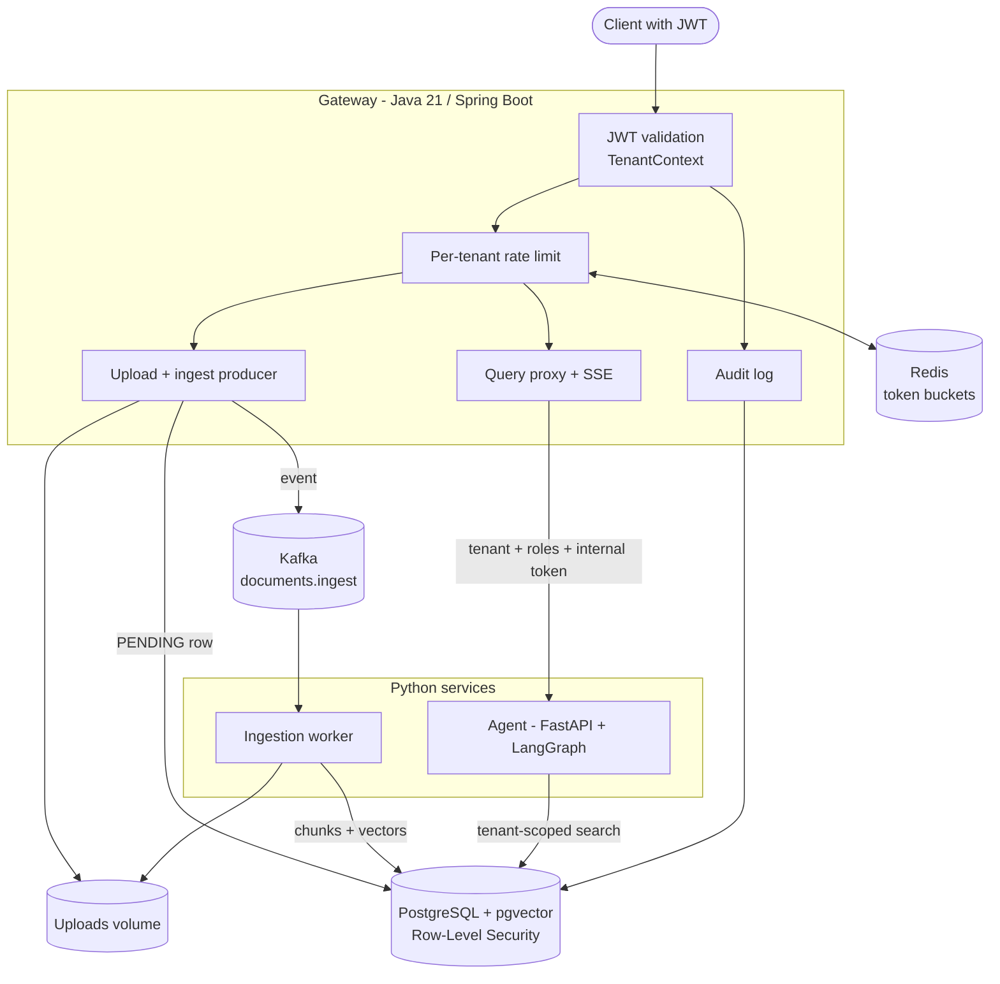
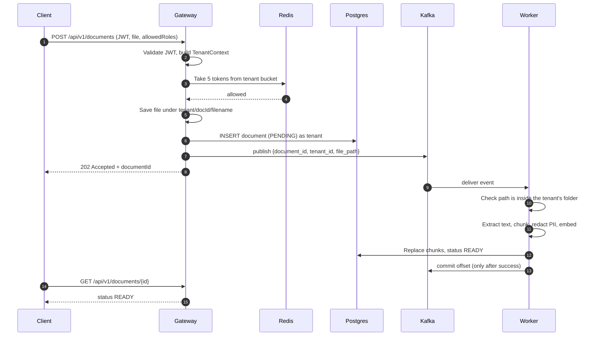
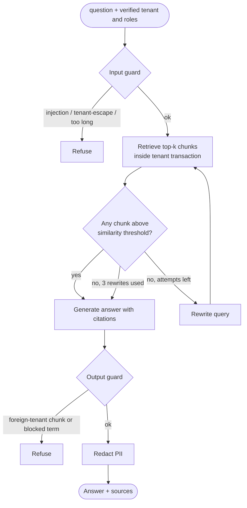
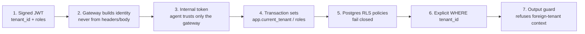

# Architecture

This document explains how the system is put together and why. For setup see [SETUP.md](SETUP.md); for a talk track see [INTERVIEW.md](INTERVIEW.md).

## 1. Components

| Component | Why it exists |
| --- | --- |
| **Gateway** (`gateway/`) | The only public entry point. Authenticates, decides *who the caller is* (tenant, roles), rate-limits, accepts uploads and forwards queries. Everything behind it trusts its identity decision. |
| **Agent** (`python/ragplatform/agent`) | Answers questions: guards the input, retrieves, grades, retries with a rewritten query, generates with citations, guards the output. Not reachable from outside. |
| **Worker** (`python/ragplatform/worker`) | Turns uploaded files into searchable chunks in the background so uploads return instantly. |
| **Kafka** | Durable queue between upload and processing; keyed by tenant so one tenant's documents stay ordered and tenants spread across partitions. |
| **Redis** | Shared state for the rate limiter, so it works across several gateway instances. |
| **Postgres + pgvector** | Metadata, chunks and vectors in one place, with isolation enforced by the database itself. |

## 2. Uploading a document

Key properties:
- The client gets an answer in milliseconds; heavy work is off the request path.
- A crash mid-document means Kafka redelivers it. Ingestion deletes and rewrites a document's chunks, so redelivery is harmless (idempotent).
- Permanent errors (bad file, forged event) are dropped immediately and the document is marked `FAILED`; transient errors (database restart) are retried 3 times with backoff.

## 3. Asking a question

- With no relevant context the generator returns "I couldn't find that in the documents you have access to" instead of guessing.
- The retry loop is bounded (default 3), so latency and cost stay bounded.
- The graph is a LangGraph state machine, which makes the control flow explicit and testable: every step is recorded in a `trace` returned with the answer.

## 4. How isolation is enforced (defence in depth)

No single layer is trusted alone:

1. **Signed identity.** Tenant and roles come from a verified token.
2. **No client-supplied identity.** The gateway ignores tenant information in requests; the agent ignores tenant words in the question.
3. **Internal token.** The agent is on a private network and also rejects calls without the gateway's secret.
4. **Transaction-local settings.** Identity is set with `set_config(..., true)` per transaction, so a pooled connection can never carry one tenant's identity into another request.
5. **Row-Level Security.** Policies compare each row's `tenant_id` to the setting. If the setting is missing the comparison is NULL and **zero rows** are visible. A second *restrictive* policy filters by `allowed_roles`. Services connect as `rag_app`, which is not a superuser and cannot bypass RLS; `FORCE ROW LEVEL SECURITY` applies it even to the table owner.
6. **Explicit predicate.** Retrieval also filters `WHERE tenant_id = ...`, so even if a policy were dropped by mistake the query alone still isolates.
7. **Output check.** If a chunk from another tenant ever appeared in context, the answer is refused.

The worker adds one more: an ingest event's file path must be inside that event's own tenant folder, and the document row must exist for that tenant (RLS hides other tenants' rows), so a forged Kafka message cannot make it read or overwrite another tenant's data.

## 5. Rate limiting

Each tenant has a token bucket in Redis (default capacity 20, refill 5 per second). A query or upload costs 5 tokens; other calls cost 1. The check-and-take runs as a single Lua script inside Redis, so concurrent requests from many gateway instances cannot overspend the bucket (tested with 16 concurrent callers: exactly `capacity` succeed). A rejected request gets `429` with a `Retry-After` header. Buckets are per tenant, so one tenant's flood does not consume another's allowance. If Redis is unreachable the limiter **fails open** (configurable) so a Redis outage doesn't take every tenant offline.

## 6. Data model

| Table | Purpose | Notable columns |
| --- | --- | --- |
| `documents` | One row per upload | `tenant_id`, `status` (PENDING/PROCESSING/READY/FAILED), `allowed_roles` |
| `chunks` | Text pieces and their vectors | `tenant_id`, `document_id`, `content`, `allowed_roles`, `embedding vector(1536)` (HNSW index, cosine) |
| `audit_log` | Who did what | `tenant_id`, `user_id`, `action`, `detail`. Queries are stored as a hash and length, not text. |

All three have RLS enabled and forced.

## 7. Technology choices and trade-offs

| Decision | Reason | Cost / alternative |
| --- | --- | --- |
| Spring MVC on virtual threads, not Spring Cloud Gateway | The gateway does blocking work (JDBC, Kafka acks); simple synchronous code on Loom is easier to reason about than reactive | Gives up reactive back-pressure |
| Kafka consumer, not Celery | Kafka already gives durable queueing, partitions and consumer groups; Celery would add a second broker | More operational weight than a simple task queue |
| Postgres RLS, not per-tenant databases | One schema to run and migrate; strong isolation enforced in the engine | Weaker blast-radius isolation than separate databases; noisy-neighbour at the DB level not handled |
| pgvector, not a dedicated vector database | One system to operate; transactional with metadata; isolation policies apply to vectors too | Less scale and fewer features than specialised vector stores |
| Shared internal token, not mTLS | Adequate inside one private network, trivial to run | mTLS or a mesh is the production upgrade |
| Shared volume, not S3 | Runs anywhere with no cloud account | Gateway and worker must share a host; `StorageService` is the seam to swap |
| Heuristic guards, not a safety model | Offline and fast | Misses sophisticated attacks; the interface is small so a classifier can replace it |
| Offline-by-default models | Runs with no keys or cost | Lexical retrieval only; use a real embedding provider for semantics |

## 8. Known limitations

See the README for the full list. The most relevant for review: no automatic retry queue for events that exhaust retries, regex-only PII redaction, no schema migration tool, single-node infrastructure, and the roadmap items for Ragas evaluation, load tests and dashboards are not built.
